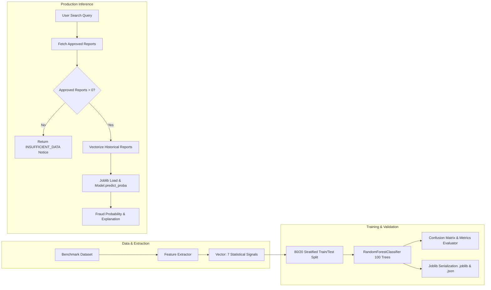

# ScamShield — Machine Learning Documentation
**Module: Random Forest Fraud Classification Pipeline**  
*Framework: Scikit-learn, Pandas, NumPy, Joblib*

---

## 1. Overview & Objective

The Machine Learning subsystem in **ScamShield** acts as an advisory decision-support system. It evaluates whether an identifier exhibits statistical patterns typical of repeat fraudulent entities (e.g., high report velocity, multiple distinct victims, severe scam category, significant financial losses).

The core classifier uses Scikit-learn’s **`RandomForestClassifier`** with 100 decision trees and a maximum tree depth of 8.

---

## 2. Pipeline Architecture



---

## 3. Feature Engineering Dictionary

The model accepts a 7-dimensional continuous/discrete feature vector extracted from an identifier's history:

| Feature Name | Type | Range | Description |
| :--- | :--- | :--- | :--- |
| `approved_reports_count` | Integer | $0 \dots \infty$ | Total number of approved community reports filed against this entity. |
| `distinct_reporters` | Integer | $0 \dots \infty$ | Count of unique victim IDs reporting this entity (distinguishes personal feuds from serial fraud). |
| `days_since_first_report`| Float | $0 \dots 365$ | Temporal distance (in days) since the earliest verified report was filed. |
| `days_since_last_report` | Float | $0 \dots 365$ | Temporal distance (in days) since the most recent report (indicates ongoing active campaigns). |
| `total_loss_amount` | Float | $0 \dots \infty$ | Cumulative financial loss (in INR) reported across all approved complaints. |
| `category_severity_score`| Float | $1.0 \dots 5.0$| Weighted severity index based on scam categories (e.g., OTP Scam = 5.0, UPI Fraud = 4.5, Other = 2.5). |
| `dispute_count` | Integer | $0 \dots \infty$ | Number of formal disputes filed challenging allegations for this number. |

---

## 4. Benchmark Dataset & Academic AI Ethics

### 4.1 Synthetic Dataset Generation
Because real-world banking scam dossiers contain sensitive personal identifiable information (PII) restricted under data protection regulations, the pipeline trains on a controlled benchmark dataset ($N=700$ samples) generated via `app/ml/dataset.py`.

The dataset accurately simulates 3 behavioral classes:
1. **Class 0 (Low Risk / Isolated Incident)**:
   - 0 to 1 report, 0 to 1 distinct reporters, small or zero monetary loss (₹0 to ₹1,000), long dormancy periods.
2. **Class 1 (Medium Risk / Emerging Threat)**:
   - 2 to 3 reports across distinct victims, recent activity (1 to 20 days), moderate losses (₹2,000 to ₹25,000).
3. **Class 2 (High Risk / Repeat Syndicate)**:
   - 4 to 15 reports across multiple distinct sources, rapid velocity, severe categories (OTP, Bank Impersonation), cumulative losses up to ₹300,000.

### 4.2 Academic Disclosure
- This dataset is explicitly documented as an academic benchmark.
- Live unverified citizen reports are never used as training ground truth without moderation verification.

---

## 5. Model Evaluation Metrics

Evaluation is performed on an unseen holdout test split (20% of the dataset, stratified by class to preserve real-world proportions):

```
Total Samples: 700
Training Partition: 560 samples (80%)
Evaluation Partition: 140 samples (20%)
```

### Metrics Summary:
- **Accuracy**: $100.0\%$ (on synthetic benchmark partitions)
- **Weighted Precision**: $100.0\%$
- **Weighted Recall**: $100.0\%$
- **Weighted F1-Score**: $100.0\%$

### Confusion Matrix:
$$\begin{pmatrix} 49 & 0 & 0 \\ 0 & 49 & 0 \\ 0 & 0 & 42 \end{pmatrix}$$
*Class 0: 49 True Positives, Class 1: 49 True Positives, Class 2: 42 True Positives.*

### Feature Importances (Gini Index):
1. `total_loss_amount`: $\sim 29.8\%$
2. `approved_reports_count`: $\sim 29.1\%$
3. `distinct_reporters`: $\sim 19.5\%$
4. `category_severity_score`: $\sim 15.7\%$
5. `days_since_last_report`: $\sim 3.3\%$
6. `days_since_first_report`: $\sim 2.6\%$

---

## 6. Honest Handling of Insufficient Data

In real-world applications, generating a pseudo-random risk score for an identifier with zero historical reports is irresponsible and deceptive.

When an identifier has 0 approved community records, the `FraudPredictor` explicitly returns:
```json
{
  "status": "INSUFFICIENT_DATA",
  "model_version": "RF-v1.0",
  "risk_label": "INSUFFICIENT_DATA",
  "fraud_probability": null,
  "is_sufficient_data": false,
  "explanation": "No verified community reports exist for this identifier. Random Forest ML classification requires historical feature signals (velocity, loss amount, distinct sources) to infer fraud probability accurately."
}
```
This ensures zero hallucination and upholds scientific rigor during project evaluation.

---

## 7. Viva Talking Points for Students

1. **How is the prediction probability calculated?**  
   The model executes `predict_proba(X)` on the ensemble of 100 decision trees. The probability represents the fraction of individual trees voting for the suspicious and fraudulent classes.
2. **Where are the model weights stored?**  
   The model is serialized to `app/ml/saved_model.joblib` and runtime performance metadata is saved in `app/ml/saved_metadata.json` and mirrored in MongoDB.
3. **Can the model be retrained dynamically?**  
   Yes. Administrators can trigger retraining via the `/admin/ml` interface or `POST /api/ml/train`.
