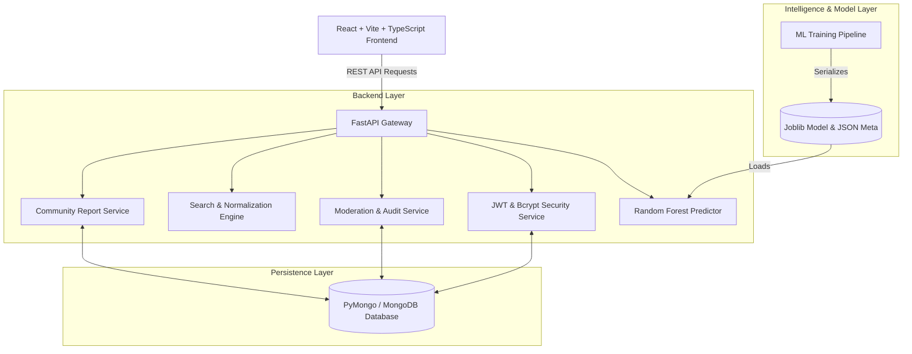
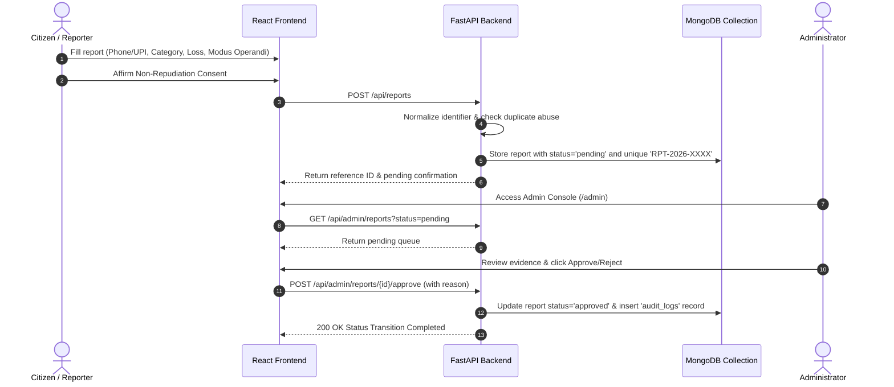

# ScamShield — Project Overview & Architecture Dossier
**Academic Demonstration: B.Tech Information Technology (Semester 7)**  
*Project Title: ScamShield — Scam Number & UPI Community Database*  

---

## 1. Executive Summary

Digital financial fraud in India has scaled exponentially following the widespread adoption of the Unified Payments Interface (UPI) and high-speed mobile connectivity. Fraudsters frequently reuse mobile numbers and UPI Virtual Payment Addresses (VPAs) across disparate victim pools before individual bank freeze mechanisms can take effect.

**ScamShield** is an undergraduate academic platform designed to address this problem through a community-driven intelligence database coupled with administrative moderation and machine-learning fraud classification.

### Core Objectives:
1. Provide a public lookup engine for citizens to check suspicious phone numbers and UPI IDs prior to initiating payments.
2. Establish a structured, non-repudiation reporting interface with multi-factor moderation.
3. Deploy an interpretable Machine Learning pipeline using Scikit-Learn’s `RandomForestClassifier` to evaluate behavioral fraud indicators (velocity, financial loss scale, repeat source reports, category severity).
4. Provide administrative governance with role-based access control (RBAC), auditing, and statistical telemetry.

---

## 2. System Architecture

---

## 3. Technology Stack Rationale

| Layer | Selected Technology | Academic Rationale |
| :--- | :--- | :--- |
| **Frontend Core** | React 18, Vite, TypeScript | Type-safe single-page application (SPA) with fast HMR and sub-second production bundling. |
| **Styling & Icons** | Tailwind CSS, Lucide React | High-contrast cyber-defense aesthetic (`#070D17` dark slate/navy) with standardized iconography. |
| **Visual Analytics**| Recharts | Composable SVG data visualizations for category distributions and identifier ratios. |
| **Backend Core** | Python 3.11, FastAPI, Pydantic | High-performance asynchronous API framework with automatic OpenAPI documentation (`/docs`). |
| **Security & Auth** | Direct Bcrypt & Python-Jose | 72-byte safe salted password hashing and stateless HMAC-SHA256 JWT sessions. |
| **Database** | MongoDB / PyMongo | Schema-flexible document storage supporting rich multi-attribute queries and indexing. |
| **Machine Learning**| Scikit-learn, Pandas, NumPy | Industry-standard `RandomForestClassifier` providing decision-tree ensembles and feature importances. |

---

## 4. Key Workflows & Data Flow

### 4.1 Community Report Lifecycle

### 4.2 Multi-Factor Search & Risk Evaluation
When a user searches for an identifier on `/search`:
1. **Identifier Normalization**:
   - Phone numbers are sanitized to Indian 10-digit mobile standards (`^[6-9]\d{9}$`) and normalized as `91XXXXXXXXXX`.
   - UPI IDs are stripped and lowercased (`username@handle`).
2. **Public Data Retrieval**:
   - Only records with `status: "approved"` are retrieved. Unverified allegations are never published.
3. **Evidence-Based Risk Scoring**:
   - Computes weighted score based on report count, distinct reporter count, average category severity, and financial loss volume.
   - Assigns community label: `NO_REPORTS`, `LOW_RISK`, `MEDIUM_RISK`, or `HIGH_RISK`.
4. **Machine Learning Advisory Signal**:
   - Checks data sufficiency: If 0 reports exist, the ML pipeline outputs `INSUFFICIENT_DATA` rather than guessing.
   - If historical evidence exists, extracts statistical feature vectors and runs `RandomForestClassifier.predict_proba()` to compute fraud probability.

---

## 5. Security & Privacy Safeguards

- **Masking of Identifiers**: All phone numbers and UPI IDs are publicly masked (`+91 98****3210`, `rah***@okhdfcbank`) across search results and public databases to prevent reverse scraping and targeted harassment.
- **Protection of Pending Allegations**: Reports remain strictly private until an authenticated moderator approves them.
- **Audit Trails**: Every moderation action (approval, rejection, duplicate flag) records the moderator email, action timestamp, and rationale in the immutable `audit_logs` collection.
- **Role-Based Access Control**: Administrative endpoints (`/api/admin/*`, `/api/ml/train`) enforce `role == "admin"` server-side.
- **Abuse Prevention**: Repeated duplicate pending submissions for the same identifier within brief time windows trigger HTTP 429 rate limits.

---

## 6. Viva Presentation Guide (Examiner FAQ)

**Q1: Why use Random Forest instead of a Deep Learning Neural Network?**  
*Answer:* Random Forest is an ensemble of decision trees with bootstrap aggregation (bagging). In financial tabular data with non-linear feature interactions (such as fraud velocity and loss volume), Random Forest outperforms deep learning on small-to-medium datasets, prevents overfitting via tree randomization, and yields interpretable Gini feature importances.

**Q2: How do you handle unverified allegations against innocent citizens?**  
*Answer:* ScamShield treats unverified reports as allegations, not criminal proof. Submissions remain in a private pending state until an authorized moderator verifies corroborating evidence. Furthermore, public numbers and UPI IDs are masked, and dispute procedures allow corrections.

**Q3: What happens if MongoDB is offline on the evaluator's machine?**  
*Answer:* The application incorporates a built-in PyMongo-compatible persistent document adapter. If a local MongoDB daemon or Atlas URI is unreachable, the system automatically runs seamlessly in offline academic demonstration mode without crashing, while supporting native Atlas clusters whenever configured in `.env`.
